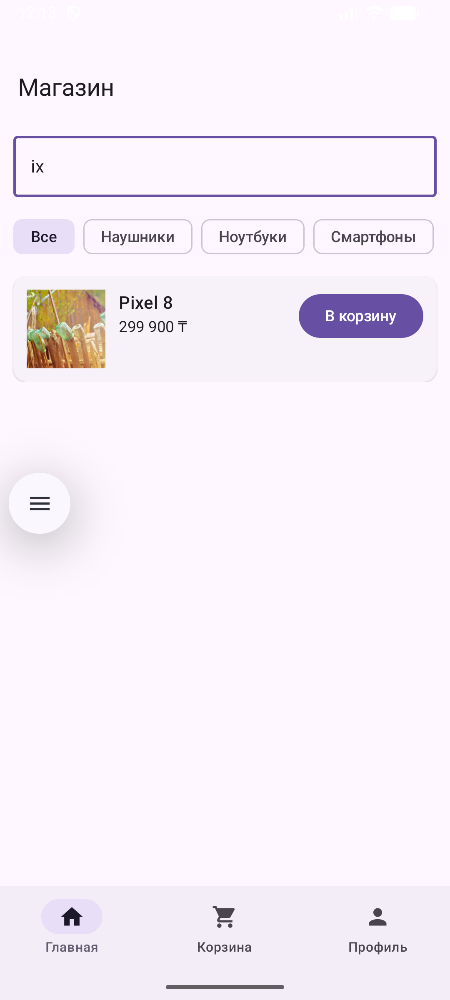
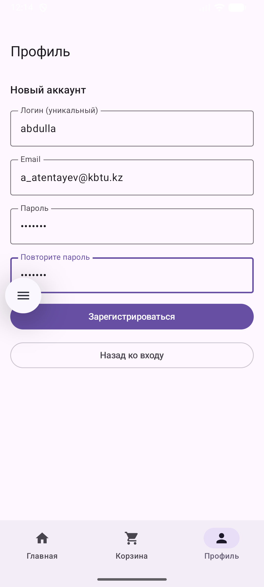

# MyNotes — mini-market Jetpack Compose

An educational Android app: a product catalog with search and category filter, product details, a shopping cart that is kept separately for each user, and registration and login. All data is stored locally in Room.

## Features

**Catalog**
- Product list with images, names and prices
- Search by product name
- Filter by category (chips)
- Product details screen

**Cart**
- Add a product from the list or from the product screen
- The "В корзину" button changes to "В корзине" once the product is in the cart
- Change quantity with − / +, remove an item when its quantity reaches zero
- Total sum and an empty-cart message
- Each user has their own cart; a guest (not logged in) has a separate cart

**Account**
- Registration: unique login, email, password and password confirmation
- After registration you are taken to the login screen and log in manually
- Login with login and password; wrong credentials show an error
- Profile shows login and email; logout returns you to a guest cart

## Stack

- Kotlin, Jetpack Compose, Material 3
- Navigation Compose (bottom navigation bar)
- ViewModel + StateFlow / Flow (`AndroidViewModel`, `stateIn`, `flatMapLatest`)
- Room (SQLite, `shop.db` file)
- Coil 3 for Images

## Structure

```
com.example.mynotes
├── MainActivity.kt         — creates ViewModel and launch MainScaffold
├── MynotesApp.kt           — Application, Coil launch
├── navigation/Routes.kt    — Routes: home, cart, profile, product?productId
├── ui/
│   ├── MainScaffold.kt     — Scaffold, bottom navigation, NavHost
│   ├── home/HomeScreen.kt  — search, filter-tags, items list
│   ├── product/ProductScreen.kt
│   ├── cart/CartScreen.kt  — list of cart items, total sum, buttons +/−
│   ├── profile/ProfileScreen.kt — login, registration, logout
│   └── theme/              — colors, theme
├── viewmodel/
│   ├── AuthViewModel.kt    — userId, login, register, logout
│   ├── CartViewModel.kt    — items, total, add, changeQty
│   └── ProductViewModel.kt — products, categories, setQuery, setCategory
└── data/
    ├── AppDatabase.kt      — Room, creates Database and inital data
    ├── entity/             — Product, Category, User, ShoppingCart, CartItem etc.
    ├── dao/                — ProductDao, CartDao, UserDao
    └── repo/               — ProductRepository, CartRepository, AuthRepository[README.en.md](README.en.md)
```

## How the app works

Data flows along the chain **Room → DAO → Repository → ViewModel → Composable**. User actions flow in the opposite direction: **Composable → ViewModel → Repository → DAO**.

- **Search and filter.** Typing in the search field calls `ProductViewModel.setQuery()`, and selecting a category chip calls `setCategory()`. The ViewModel combines both values with `combine` and `flatMapLatest` and queries Room. The SQL query `observeByQueryAndCategory` filters by name (`LIKE`) and category. The list updates automatically.
- **Cart.** The "В корзину" button calls `CartViewModel.add()`. `productIds` is derived from the cart items, so the button label updates as soon as the item is saved. Quantity is changed with `changeQty()`.
- **Per-user cart.** When the logged-in user changes, `MainActivity` calls `CartViewModel.ensureCart(userId)`, which finds or creates the cart for that user (`CartDao.getCartFor`). A guest uses a cart with no owner.
- **Total.** The sum (`total`) is computed in `CartViewModel` with `map` over the cart items.
- **Authentication.** `AuthViewModel` keeps the current `User` as a `StateFlow`, and `userId` is derived from it. Passwords are hashed with SHA-256 (`AuthRepository`).


## State

- **ViewModel** holds data that must outlive the screen: the current user, the cart, the product list, the current search query and category.
- **`remember`** holds local screen state: the loaded product on `ProductScreen`, the password fields and messages on `ProfileScreen`, the search field and selected category on `HomeScreen`.
- **`rememberSaveable`** keeps the login/registration mode and the login/email fields on `ProfileScreen` across rotation.

## Running the app

1. On the repository page, click **Code → Download ZIP**.
2. Extract the archive.
3. In Android Studio, select **File → Open** and choose the extracted folder (the one containing `settings.gradle.kts`).
4. Wait for **Gradle Sync** to finish, select an emulator or device, and click **Run ▶** (`Shift + F10`).

On first launch, the `shop.db` database is created automatically and filled with four products and three categories.

### Test actions

- **Search:** type "Pixel" or "ThinkPad" in the search field on the home screen.
- **Filter:** select the "Ноутбуки" (Laptops) or "Наушники" (Headphones) category chip.
- **Cart:** add a product from the home screen; the button changes to "В корзине". Change its quantity on the "Корзина" tab.
- **Per-user cart:** add a product as a guest, then register or log in as a user. The user's cart is empty, while the guest cart is still there after logout.
- **Registration:** Профиль → "Создать аккаунт" → fill in login, email, password and password repeat → "Зарегистрироваться". You will see a success message and the login screen.
- **Login:** enter the login and password you registered with → "Войти". The profile shows your login and email.

## Limitations

- Checkout is not implemented yet (placeholder button).
- Data is stored only on the device; there is no server.
- Login uniqueness is checked in code, not by a database constraint.
- Passwords are hashed with SHA-256

## Screenshots

| Home | Search | Category filter | Product |
|---|---|---|---|
|  |  |  |  |

| Registration | Login | Profile | Cart |
|---|---|---|---|
|  |  |  |  |