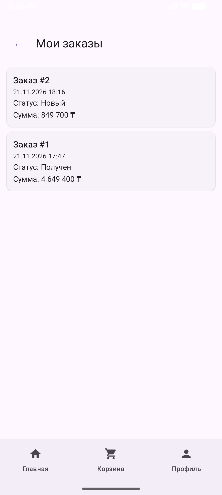

# MyNotes — mini-market on Jetpack Compose

An educational Android app: a product catalog with search and category filter, product details, a shopping cart that is kept separately for each user, and registration and login. All data is stored locally in Room.

## New in this version

- **Delivery addresses (CRUD).** Create, view, edit and delete addresses. The form validates every field, and deleting an address asks for confirmation.
- **Checkout.** The cart is turned into an order. You pick a delivery address, and the order, its items and the cleared cart are saved in one transaction.
- **Order workflow.** Orders move through the statuses **New → Paid → Shipped → Delivered**. An order can be cancelled only before payment, and each step is confirmed by the user.
- **Order history and details.** The list of your orders, and a details screen with a status timeline, items, delivery address and payments.
- **Feedback.** Empty states for every list, and Snackbar messages after each action.

## Stack

- Kotlin, Jetpack Compose, Material 3
- Navigation Compose (bottom navigation with three tabs; product, address and order screens)
- ViewModel + StateFlow / Flow (`AndroidViewModel`, `stateIn`, `flatMapLatest`), collected with `collectAsStateWithLifecycle()` (`lifecycle-runtime-compose`)
- Room (SQLite, `shop.db`, schema version 2 with a migration)
- Coil 3 for images

## Structure

```
com.example.mynotes
├── MainActivity.kt         — creates ViewModels, updates cart, addresses and orders when the user changes
├── MynotesApp.kt           — Application, Coil configuration
├── navigation/Routes.kt    — routes: home, cart, profile, product, addresses, address form, orders, order details
├── ui/
│   ├── MainScaffold.kt     — Scaffold, bottom navigation, NavHost
│   ├── common/Common.kt    — shared composables: EmptyState, ConfirmDialog; price and date formatting
│   ├── home/HomeScreen.kt  — search, category chips, product list
│   ├── product/ProductScreen.kt
│   ├── cart/CartScreen.kt  — cart items, delivery address selection, checkout
│   ├── address/AddressesScreen.kt   — address list with edit and delete
│   ├── address/AddressFormScreen.kt — create and edit form with validation
│   ├── orders/OrdersScreen.kt       — order list
│   ├── orders/OrderDetailScreen.kt  — status timeline, items, payments, status actions
│   ├── profile/ProfileScreen.kt     — login, registration, profile, logout, links to addresses and orders
│   └── theme/              — colors, typography, theme
├── viewmodel/
│   ├── AuthViewModel.kt    — current user, login, register, logout
│   ├── CartViewModel.kt    — items, total, productIds, add, changeQty, checkout
│   ├── ProductViewModel.kt — products, categories, query, selectedCategory, setQuery, setCategory
│   ├── AddressViewModel.kt — addresses, save (with validation), delete
│   └── OrderViewModel.kt   — orders, details of the selected order, pay, ship, deliver, cancel
└── data/
    ├── AppDatabase.kt      — Room database, migration 1 → 2, seed data
    ├── OrderStatus.kt      — order statuses and their labels
    ├── entity/             — Product, Category, User, ShoppingCart, CartItem, UserAddress, Order, OrderItem, Payment, Review
    ├── dao/                — ProductDao, CartDao, UserDao, AddressDao, OrderDao (transactions)
    └── repo/               — ProductRepository, CartRepository, AuthRepository, AddressRepository, OrderRepository
```

## How the app works

Data flows along the chain **Room → DAO → Repository → ViewModel → Composable**. User actions flow in the opposite direction: **Composable → ViewModel → Repository → DAO**.

- **Addresses.** `AddressViewModel.save()` validates the form and returns either field errors (`SaveResult.Invalid`), an error message (`SaveResult.Failed`) or success (`SaveResult.Saved`). Editing checks that the address belongs to the current user. `delete()` runs only for the owner's addresses, and the UI asks for confirmation first.
- **Checkout.** `CartViewModel.checkout()` calls `OrderDao.placeOrder()`, a `@Transaction` that creates the order, copies the cart items with their current prices, writes the address as text into the order and clears the cart. If the cart is empty, nothing is saved.
- **Status transitions.** Every transition is an SQL update with a condition, for example `UPDATE Orders SET status = 'PAID' WHERE orderId = ? AND status = 'NEW'`. If the order is already in another status, nothing changes and the user sees a message. Payment (`OrderDao.pay()`) changes the status and writes a row to `Payments` in one transaction.
- **Selected order.** `OrderViewModel.selectOrder()` stores the id of the order on the details screen, so the screen keeps its data after rotation. The status actions shown depend on the current status: *New* offers Pay and Cancel, *Paid* offers Ship, *Shipped* offers Confirm delivery.
- **Per-user data.** Addresses, orders and the cart are loaded for the current user. After login or logout, `MainActivity` switches all of them.

## Running the app

1. On the repository page, click **Code → Download ZIP**.
2. Extract the archive.
3. In Android Studio, select **File → Open** and choose the extracted folder (the one containing `settings.gradle.kts`).
4. Wait for **Gradle Sync** to finish, select an emulator or device, and click **Run ▶** (`Shift + F10`).

On first launch, the `shop.db` database is created automatically and filled with four products and three categories. If you installed an earlier version, the database is upgraded automatically and existing data is kept.

### Test actions

- **Search:** type "Pixel" or "ThinkPad" in the search field on the home screen.
- **Filter:** select the "Ноутбуки" (Laptops) or "Наушники" (Headphones) category chip.
- **Cart:** add a product from the home screen; the button changes to "В корзине". Change its quantity on the "Корзина" tab.
- **Per-user cart:** add a product as a guest, then register or log in as a user. The user's cart is empty, while the guest cart is still there after logout.
- **Registration:** Профиль → "Создать аккаунт" → fill in login, email, password and password repeat → "Зарегистрироваться". You will see a success message and the login screen.
- **Login:** enter the login and password you registered with → "Войти". The profile shows your login and email.
- **Addresses:** Профиль → "Мои адреса" → "+" → add an address. Try a 5-digit index to see the validation message. Then edit it and delete it, confirming the dialog.
- **Order:** add a product to the cart, select an address on the Cart tab, press "Оформить заказ". On the order screen press "Оплатить", then "Отправить", then "Подтвердить получение".
- **Cancel:** create a new order and press "Отменить заказ" before paying. The order is marked as cancelled.

## Limitations

- Payment is simulated: "Оплатить" marks the order as paid and creates a test payment record.
- Shipping is simulated: the courier step is a button.
- Orders can be cancelled only before payment. There is no refund flow.
- Delivery addresses are checked only for filled fields and a 6-digit index. The address itself is not verified.
- Data is stored only on the device; there is no server.
- Login uniqueness is checked in code, not by a database constraint.
- Passwords are hashed with SHA-256 without a salt; this is for educational purposes only.
- The `Review` table exists in the database, but reviews are not implemented.

## Screenshots

| Addresses (empty) | Address form with errors | Delete confirmation |
|---|---|---|
|  |  |  |

| Cart with checkout | Orders list | Order details |
|---|---|---|
|  |  |  |
